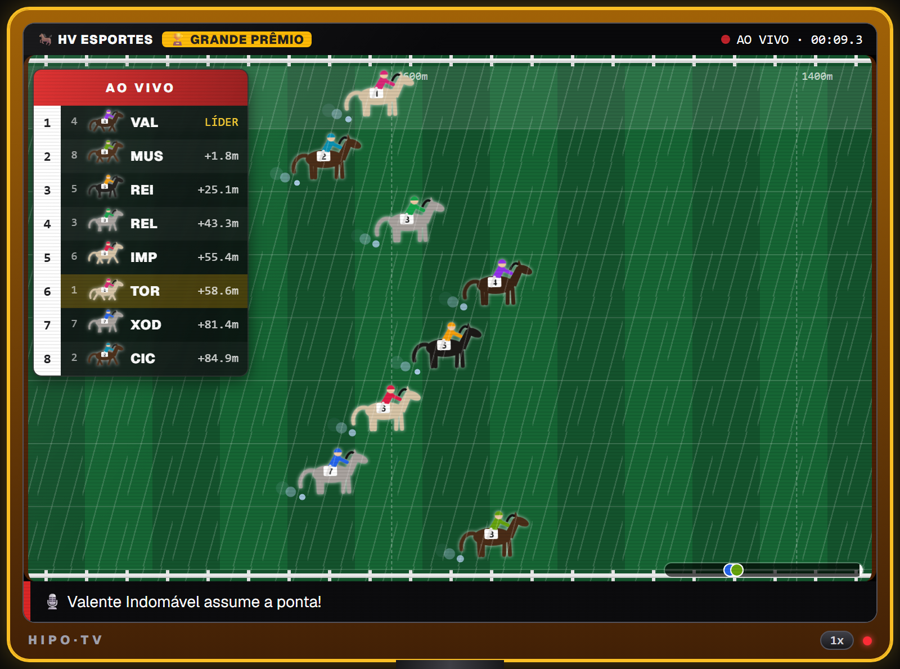
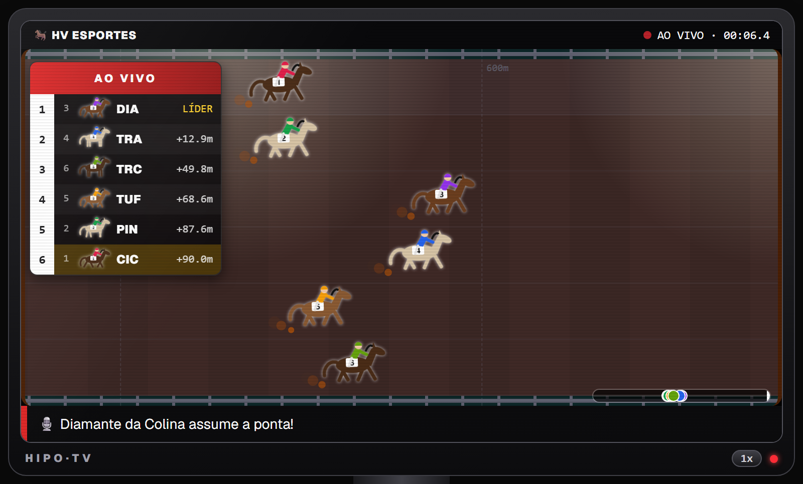
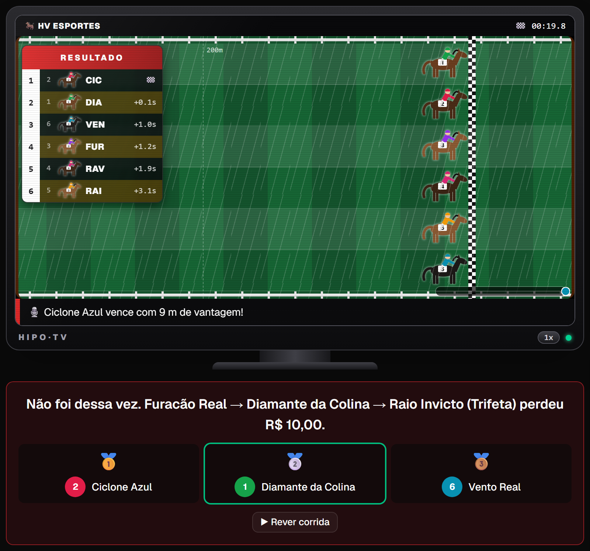
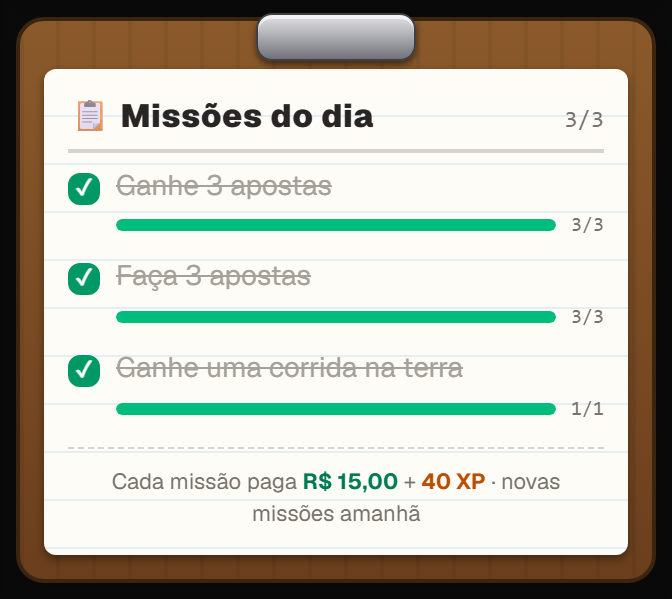
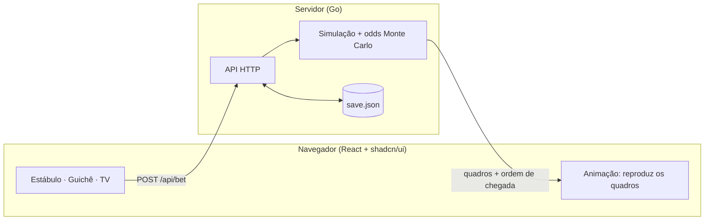

<div align="center">


# Hipódromo Virtual

**Simulador de apostas em corridas de cavalos, com transmissão ao vivo, estábulo, guichê de apostas e muito mais.**


</div>

> [!NOTE]
> Projeto de estudo. Todo o dinheiro do jogo é fictício: não há pagamentos nem dinheiro real envolvido.

---

## ✨ Destaques

- 📺 **Corrida transmitida numa TV**, com **câmera que acompanha o líder**, minimapa, narração na tarja e **classificação estilo F1** sobreposta à imagem.
- 🎲 **O servidor decide a corrida.** O navegador só reproduz os quadros, então não dá pra trapacear pelo console.
- 📈 **Odds honestas**: cada páreo é simulado **3.000 vezes** (Monte Carlo) antes de abrir, com 10% de margem da casa.
- 🐴 **Elenco fixo de 30 cavalos** que voltam a correr, cada um com **ficha dos últimos resultados** e uma característica: 💧 gosta de lama, 🏅 bom numa superfície ou 💪 fôlego longo.
- 🏇 **8 jóqueis** com nome, cor e estrelas de habilidade.
- 🌦️ **Pistas variadas**: grama, areia e terra; seca, molhada ou pesada (terra + chuva = **barro**); 800 a 1600 m; e **corridas noturnas** sob holofotes.
- 🏆 **Grande Prêmio a cada 10 páreos**: 2400 m, 8 cavalos, odds sem margem da casa e XP em dobro.
- 🎟️ **Cinco tipos de aposta**: Vencedor, Placê (1º ou 2º), Dupla (1º e 2º em qualquer ordem), **Exata** (1º e 2º na ordem) e **Trifeta** (1º, 2º e 3º na ordem).
- 🎪 **Guichê de apostas** com o Seu Zé (que até dá palpites), fichas de cassino e **bilhete impresso** com carimbo de PAGO ou NÃO PREMIADO.
- 📋 **Missões diárias**, **14 troféus**, **níveis com XP**, sequência de vitórias, **bônus diário** e histórico num quadro-negro.
- 🔊 **Áudio 100% sintetizado** (sem arquivos): trilha sonora, cascos, sino de largada, torcida e **narração falada** em português.
- 🎥 **Câmera lenta no photo finish** e botão de **rever corrida**.

## 📸 Telas

<table>
  <tr>
    <td colspan="2"><br /><sub><b>Grande Prêmio</b>: 8 cavalos em 2400 m, TV dourada, câmera seguindo o líder e minimapa no canto.</sub></td>
  </tr>
  <tr>
    <td width="50%"><br /><sub><b>Corrida noturna</b>: pista escura com holofotes e a torre de classificação ao vivo.</sub></td>
    <td width="50%"><br /><sub><b>Barro debaixo de chuva</b>: terra pesada, poças e lama saindo dos cascos.</sub></td>
  </tr>
  <tr>
    <td colspan="2"><br /><sub><b>Resultado</b>: diferenças de tempo pro vencedor, pódio e botão de rever a corrida.</sub></td>
  </tr>
  <tr>
    <td colspan="2"><br /><sub><b>Estábulo</b>: uma baia por cavalo, com jóquei, odds em giz, característica e a ficha das últimas corridas. Os selos 1º, 2º e 3º mostram uma trifeta sendo montada.</sub></td>
  </tr>
</table>

<table>
  <tr>
    <td width="33%"><br /><sub><b>Guichê</b> montando uma trifeta.</sub></td>
    <td width="33%"><br /><sub><b>Bilhete</b> carimbado no fim da corrida.</sub></td>
    <td width="33%"><br /><sub><b>Missões do dia</b>.</sub></td>
  </tr>
  <tr>
    <td width="33%"><br /><sub><b>Estante de troféus</b>.</sub></td>
    <td width="33%" colspan="2"><br /><sub><b>Quadro</b> com os últimos páreos.</sub></td>
  </tr>
</table>

## 🚀 Como rodar

Você precisa de **Go 1.27+** e **Node.js 22+**.

```sh
# 1. compilar o front-end
cd frontend
npm install
npm run build

# 2. subir o servidor (ele serve o front já compilado)
cd ../backend
go run .
```

Abra **http://localhost:8080** e boas apostas.

**Desenvolvendo o front** com recarga automática: deixe o `go run .` ligado e, em outro terminal, rode `npm run dev` dentro de `frontend/`. O Vite repassa as chamadas `/api` para a porta 8080.

### ⌨️ Atalhos

| Tecla | Ação |
| --- | --- |
| `1` a `8` | Escolhe o cavalo (na Exata e na Trifeta, na ordem de chegada) |
| `Enter` | Aposta e larga |

## 🧠 Como funciona



1. **Ao abrir um páreo**, o servidor escala 6 cavalos do elenco (2 de cada característica; 8 no Grande Prêmio), sorteia jóqueis, superfície, condição da pista e distância, e simula a corrida 3.000 vezes pra calcular as odds de **vencedor**, **placê**, **dupla**, **exata** e **trifeta**.
2. **Cada cavalo do elenco** tem atributos escondidos e fixos (velocidade, fôlego, aceleração, arrancada final e afinidade com lama ou com uma superfície). O jóquei soma um pouco de velocidade. A velocidade muda de forma suave a cada quadro: os cavalos aceleram na largada, cansam e arrancam no fim. A ficha de cada cavalo guarda os últimos 5 resultados.
3. **Ao apostar**, o servidor valida a aposta, roda a corrida de verdade, paga o prêmio (em centavos) e devolve todos os quadros da corrida.
4. **O navegador só anima** esses quadros, com narração, classificação e sons.

### API

| Método | Rota | O que faz |
| --- | --- | --- |
| `GET` | `/api/race` | Páreo atual, odds, saldo, estatísticas, missões e disponibilidade do bônus |
| `POST` | `/api/bet` | Faz a aposta `{ raceId, horseId, horse2, horse3, amount, type }` e devolve a corrida |
| `POST` | `/api/bonus` | Resgata o bônus diário (uma vez por dia) |
| `POST` | `/api/reset` | Recarrega o saldo para R$ 100,00 |

Os valores são em **centavos** (`10000` = R$ 100,00). `type` é `win`, `place`, `dupla`, `exata` ou `trifeta`; na exata e na trifeta, `horseId`, `horse2` e `horse3` são o 1º, o 2º e o 3º.

## 📁 Estrutura

```
.
├── backend/              # servidor Go (só biblioteca padrão)
│   ├── main.go           # API, apostas, conquistas, níveis, bônus, salvamento
│   ├── race.go           # elenco, jóqueis, pistas, simulação e odds
│   ├── missions.go       # missões diárias
│   └── race_test.go      # testes
├── frontend/             # React + Vite + Tailwind + shadcn/ui
│   └── src/
│       ├── App.tsx       # tela principal, animação e narração
│       ├── components/   # track, stable, booth, tower, missions, trophies, board
│       └── lib/sound.ts  # trilha sonora, efeitos sintetizados e voz do narrador
└── docs/screenshots/     # imagens deste README
```

## 🧪 Testes

```sh
cd backend
go test ./...
```

Os testes cobrem: validação de apostas, ordem de chegada, pagamentos de vencedor, placê, dupla, exata e trifeta, margem da casa nas odds, Grande Prêmio, elenco e fichas sobrevivendo ao reinício, distribuição das características, missões, sequência de vitórias, conquistas, bônus diário e níveis.

## 💾 Salvamento

Saldo, estatísticas, histórico, troféus, XP, missões e o elenco (com as fichas dos cavalos) ficam em `backend/save.json`. Apague esse arquivo para recomeçar do zero.
