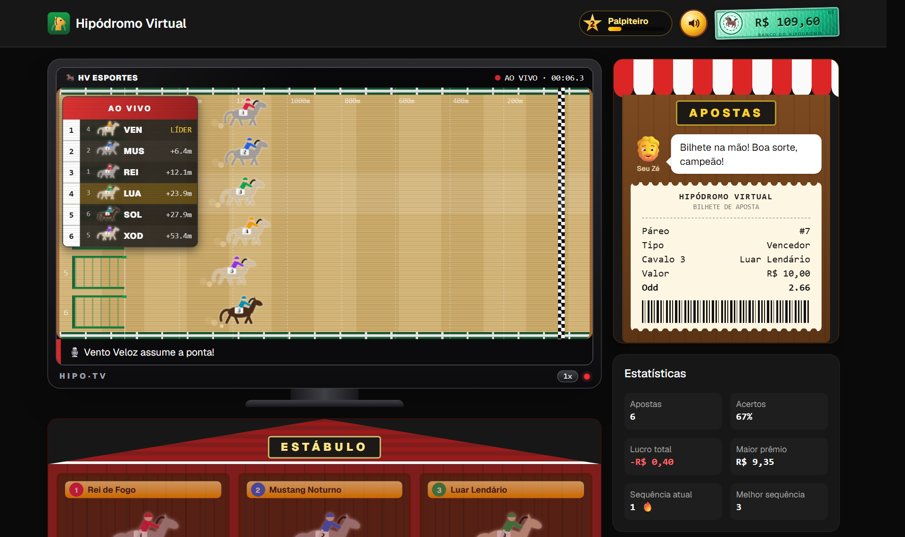
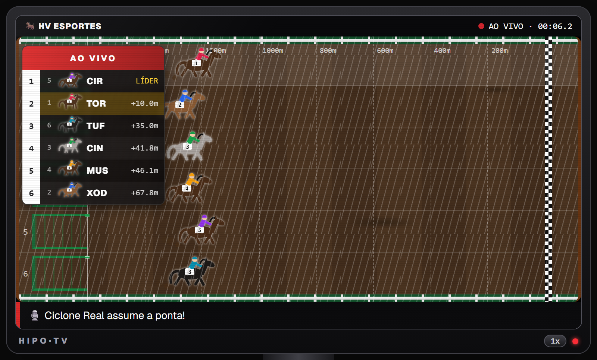
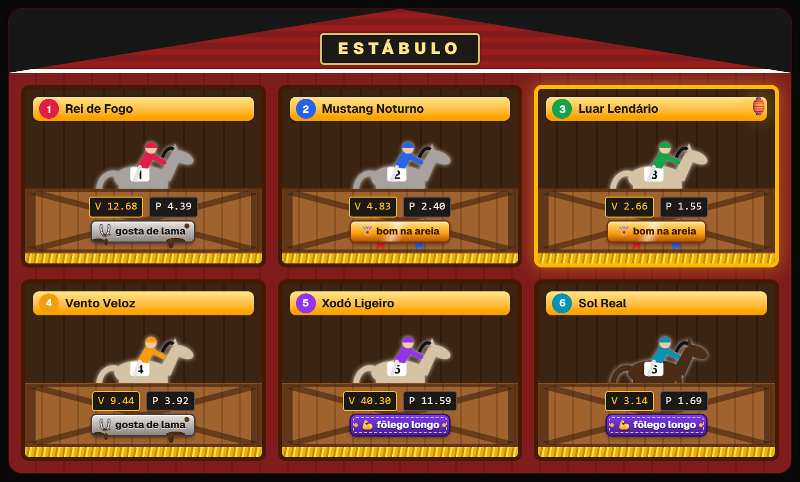
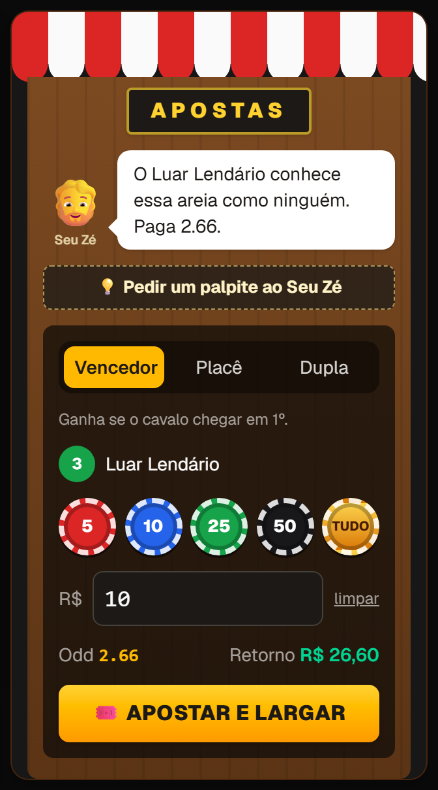
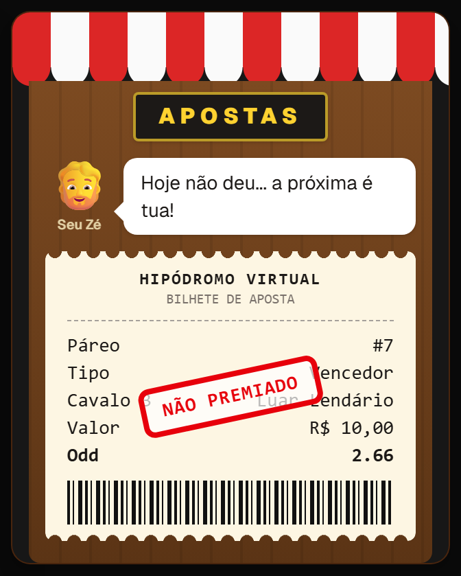
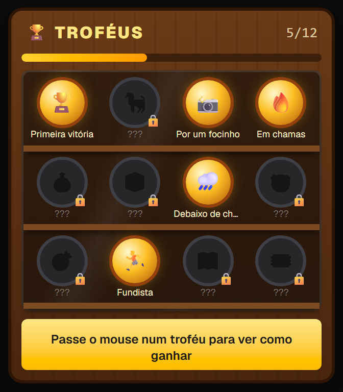
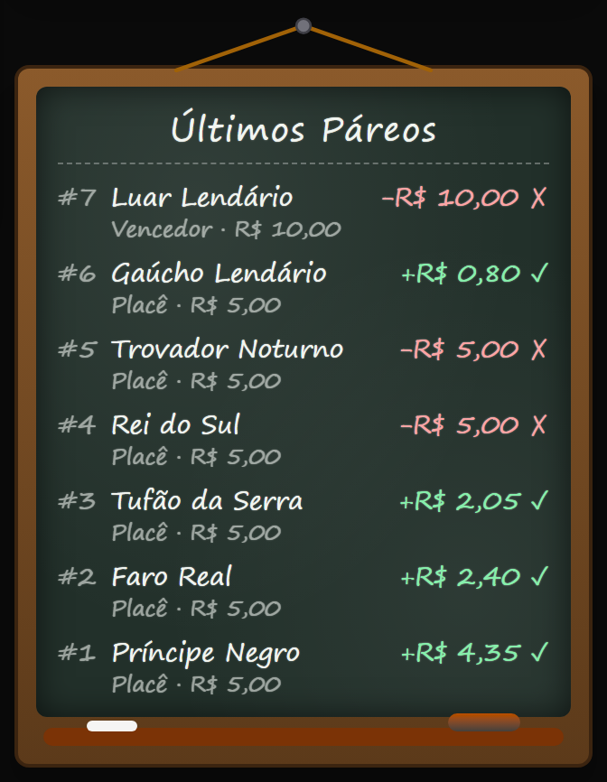
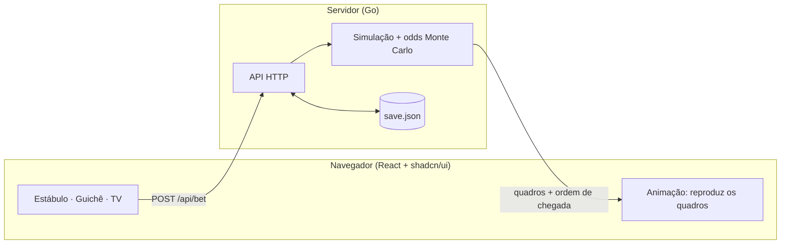

<div align="center">


# Hipódromo Virtual

**Simulador de apostas em corridas de cavalos, com transmissão ao vivo, estábulo, guichê de apostas e muito mais.**




</div>

> [!NOTE]
> Projeto de estudo. Todo o dinheiro do jogo é fictício: não há pagamentos nem dinheiro real envolvido.

---

## ✨ Destaques

- 📺 **Corrida transmitida numa TV**, com placar de tempo, narração na tarja e **classificação estilo F1** sobreposta à imagem.
- 🎲 **O servidor decide a corrida.** O navegador só reproduz os quadros, então não dá pra trapacear pelo console.
- 📈 **Odds honestas**: cada páreo é simulado **3.000 vezes** (Monte Carlo) antes de abrir, com 10% de margem da casa.
- 🏇 **Cavalos com nomes sorteados** e uma característica cada: 💧 gosta de lama, 🏅 bom na superfície ou 💪 fôlego longo.
- 🌦️ **Pistas variadas**: grama, areia e terra; seca, molhada ou pesada (terra + chuva = **barro**); 800 a 1600 m; e **corridas noturnas** sob holofotes.
- 🎟️ **Três tipos de aposta**: Vencedor, Placê (1º ou 2º) e Dupla (1º e 2º em qualquer ordem).
- 🎪 **Guichê de apostas** com o Seu Zé, fichas de cassino e **bilhete impresso** com carimbo de PAGO ou NÃO PREMIADO.
- 🏆 **12 troféus**, **níveis com XP**, sequência de vitórias, **bônus diário** e histórico num quadro-negro.
- 🔊 **Sons sintetizados** (sem arquivos de áudio): cascos, sino de largada, torcida e **narração falada** em português.
- 🎥 **Câmera lenta no photo finish** e botão de **rever corrida**.

## 📸 Telas

<table>
  <tr>
    <td width="50%"><br /><sub><b>Corrida noturna</b>: pista escura com holofotes e a torre de classificação ao vivo.</sub></td>
    <td width="50%"><br /><sub><b>Barro debaixo de chuva</b>: terra pesada, poças e lama saindo dos cascos.</sub></td>
  </tr>
  <tr>
    <td colspan="2"><br /><sub><b>Resultado</b>: diferenças de tempo pro vencedor, pódio e botão de rever a corrida.</sub></td>
  </tr>
  <tr>
    <td colspan="2"><br /><sub><b>Estábulo</b>: uma baia por cavalo, com odds em giz e a característica de cada um.</sub></td>
  </tr>
</table>

<table>
  <tr>
    <td width="25%"><br /><sub><b>Guichê</b> com o palpite do Seu Zé.</sub></td>
    <td width="25%"><br /><sub><b>Bilhete</b> carimbado no fim da corrida.</sub></td>
    <td width="25%"><br /><sub><b>Estante de troféus</b>.</sub></td>
    <td width="25%"><br /><sub><b>Quadro</b> com os últimos páreos.</sub></td>
  </tr>
</table>

## 🚀 Como rodar

Você precisa de **Go 1.27+** e **Node.js 22+**.

```sh
# 1. compilar o front-end
cd frontend
npm install
npm run build

# 2. subir o servidor (ele serve o front já compilado)
cd ../backend
go run .
```

Abra **http://localhost:8080** e boas apostas.

**Desenvolvendo o front** com recarga automática: deixe o `go run .` ligado e, em outro terminal, rode `npm run dev` dentro de `frontend/`. O Vite repassa as chamadas `/api` para a porta 8080.

### ⌨️ Atalhos

| Tecla | Ação |
| --- | --- |
| `1` a `6` | Escolhe o cavalo |
| `Enter` | Aposta e larga |

## 🧠 Como funciona



1. **Ao abrir um páreo**, o servidor sorteia 6 cavalos, a superfície, a condição da pista e a distância, e simula a corrida 3.000 vezes pra calcular as odds de **vencedor**, **placê** e de cada **dupla**.
2. **Cada cavalo** tem atributos escondidos (velocidade, fôlego, aceleração, arrancada final e afinidade com a pista). A velocidade muda de forma suave a cada quadro: os cavalos aceleram na largada, cansam e arrancam no fim.
3. **Ao apostar**, o servidor valida a aposta, roda a corrida de verdade, paga o prêmio (em centavos) e devolve todos os quadros da corrida.
4. **O navegador só anima** esses quadros, com narração, classificação e sons.

### API

| Método | Rota | O que faz |
| --- | --- | --- |
| `GET` | `/api/race` | Páreo atual, odds, saldo, estatísticas e disponibilidade do bônus |
| `POST` | `/api/bet` | Faz a aposta `{ raceId, horseId, horse2, amount, type }` e devolve a corrida |
| `POST` | `/api/bonus` | Resgata o bônus diário (uma vez por dia) |
| `POST` | `/api/reset` | Recarrega o saldo para R$ 100,00 |

Os valores são em **centavos** (`10000` = R$ 100,00). `type` é `win`, `place` ou `dupla`.

## 📁 Estrutura

```
.
├── backend/              # servidor Go (só biblioteca padrão)
│   ├── main.go           # API, apostas, conquistas, níveis, bônus, salvamento
│   ├── race.go           # cavalos, pistas, simulação e odds
│   └── race_test.go      # testes
├── frontend/             # React + Vite + Tailwind + shadcn/ui
│   └── src/
│       ├── App.tsx       # tela principal, animação e narração
│       ├── components/   # track, stable, booth, tower, trophies, board
│       └── lib/sound.ts  # sons sintetizados e voz do narrador
└── docs/screenshots/     # imagens deste README
```

## 🧪 Testes

```sh
cd backend
go test ./...
```

Os testes cobrem: validação de apostas, ordem de chegada, pagamentos de vencedor, placê e dupla, margem da casa nas odds, uma característica por cavalo, salvamento, sequência de vitórias, conquistas, bônus diário e níveis.

## 💾 Salvamento

Saldo, estatísticas, histórico, troféus e XP ficam em `backend/save.json`. Apague esse arquivo para recomeçar do zero.
